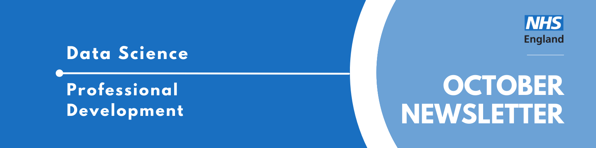

Welcome to the latest newsletter from the Data Science Community for Health and Care, brought to you by the NHS England Data Science Professional Development Functional Team. 

The newsletter team are always happy to receive constructive feedback, and we invite you to send us any contributions you may have. 

If you cannot access something of interest to you, please [reach out](https://github.com/nhsengland/datascience-pd-newsletter/issues/new){target="_blank"}. 

Thanks for reading! – newsletter team 

# Interview with a Data Scientist - What 8 Weeks as a Data Science Intern Taught Me

This month we are sharing a blog post from Sofia Alabi, who recently spent 8 weeks as a data science intern at NHS England. 

Sofia, a former Healthcare Assistant, built a pipeline to test whether the [Predicted Length of Stay (PLoS)](https://nhsengland.github.io/datascience/our_work/ds_314_plos/){target="_blank"} model performs fairly across sex, ethnicity, age group and BMI. 
In the post, she reflects on what the work taught her about data quality, small sample sizes and the limits of fairness metrics.

  
Read more...

During my internship at NHS England, I had the opportunity to work on something that genuinely matters: making sure an AI model works fairly for every patient, not just on average. Coming from a healthcare background as a former Healthcare Assistant, it was especially meaningful to work on a project focused on improving the understanding of patient pathways and outcomes through data.

The project centred on a Predicted Length of Stay (PLoS) model that classifies patients into one of four stay bands (0–1 day, 2–3 days, 4–7 days, 8+ days). My task was to build a bias and fairness assessment pipeline from scratch to evaluate whether the model performed equally across demographic groups.

### What I built

Using Python, I developed a fairness assessment pipeline that evaluated model performance across key demographic groups using established open-source tools and statistical methods, including Fairlearn. The pipeline assessed performance across four protected characteristics: sex, ethnicity, age group and BMI. It also used bootstrap confidence intervals (500 resamples) to help distinguish genuine disparities from statistical variation in smaller groups.

### What I found

Because the dataset was collected for clinical care rather than analytics, some demographic fields were recorded more consistently than others, which shaped how confidently we could compare model performance across groups. Linking to centrally curated datasets could strengthen future fairness assessments.

Confidence intervals told an equally important story. Some smaller demographic groups showed apparent differences in model performance, but limited representation meant those comparisons were statistically uncertain. This highlighted the importance of considering both data quality and sample size when interpreting fairness results.

### What I learned

Beyond the technical skills, including Git, Python, Fairlearn and statistical testing, this project taught me that fairness in AI is not a technical problem with a purely technical solution. The biggest differences were often linked to who was represented in the data, how completely demographic information was recorded and the realities of how clinical data is captured in practice. A model can only be as fair as the data and systems behind it. This changed how I think about AI. It is as much about understanding data as it is about writing code.

I also learned the importance of being honest about limitations. We found natural variation in how BMI and ethnicity were recorded across sources, which influenced how we interpreted results. Fairlearn measures association, not causation, and recognising these limitations is a critical part of responsible analysis.

Fairness work is about people, processes and data, not just algorithms. Being transparent about limitations is not a weakness in the work; it is an essential part of the work itself.

Grateful to NHS England and the PLoS Team for the opportunity to contribute to something with real clinical impact.

___

We hope you have enjoyed reading about Sofia's internship! You can find the [original blog post](https://nhsengland.github.io/datascience/articles/2026/10/16/plos-bias-and-fairness-pipeline/){target="_blank"} and more about the [PLoS project](https://nhsengland.github.io/datascience/our_work/ds_314_plos/){target="_blank"} on the NHS England Data Science website. 

If you are interested in learning more about the Data Scientists working in healthcare, you can read our previous iterations of the ["Interview with a Data Scientist"](https://nhsengland.github.io/datascience/articles/category/data-science-interviews/){target="_blank"} series.

___

# The Virtual NHS Open Analytics Unconference

**Thursday 26th November 2026, 09:30 - 12:30, Online**

The NHS Open Analytics community and University of Edinburgh are excited to announce the inaugural Virtual NHS-OA Unconference!

To recreate the vibrancy of the ever popular unconference sessions of NHS-OA conferences of old, on November 26th we will be hosting a virtual get-together where you, the audience, get to decide the topics for discussion, move freely between 'rooms' and have your say! There will also be a chance to hang out and meet lovely new people in the more informal 'coffee area'.

* Learn more about the unconference [here](https://www.youtube.com/watch?v=04hSdQNTzZQ){target="_blank"}
* Sign up to register your interest to attend [here](https://events.teams.microsoft.com/event/87859b16-2994-4a20-b5d4-7d641874e4c1@2e9f06b0-1669-4589-8789-10a06934dc61?source=copyLinkLegacyShareLinkDialog){target="_blank"}

This is for "UK-based NHS employees and UK students aiming to become NHS employees".

___

# October Analyst X Data Science Huddle

Recently, we had our October Analyst X Data Science Huddle!

We heard from one project:

* Process Mining in the NHS

As always, thank you to our presenters for sharing their interesting work!

Missed the session? [Check out the recording and PowerPoint slides here](https://future.nhs.uk/DataAnalytics/view?objectID=56936784){target="_blank"}, where you will also find the recordings of previous huddles.

___

# November Analyst X Data Science Huddle

**Tuesday 10th November 2026, 13:30 - 14:30, Online**

The Data Science Community for Health and Care have organised the next Analyst X Data Science Huddle for November. We will hear from two projects:

**Using classification and regression trees (CART) to investigate unknown ethnicity records in NHS emergency care data Presented by Grace Dean**

Time: 13:30 – 14:00

High-quality ethnicity data is necessary for tackling health inequalities. This study analysed 24.2 million Emergency Care Data Set (ECDS) records from 2023/24 to (a) investigate
 variation in unknown ethnicity records, (b) explore patterns of missingness between ethnicity and other variables, and (c) identify the variables most important in the recording of an unknown ethnicity.

Variation in unknown ethnicity recording was identified by age, organisation type, and attendance characteristics. Unknown ethnicity was associated with increased missingness
 across 62 other ECDS variables. Provider site code emerged as the strongest predictor of unknown ethnicity recording, with a small number of acute trusts and independent sector organisations contributing disproportionately.

Recommendations for future work focus on improving data collection processes for individual organisations, which would provide direct benefits for NHS England and NHS providers,
 and is necessary for tackling health inequalities.

Here's a link to the paper in [BMJ Open](https://bmjopen.bmj.com/content/16/8/e118200){target="_blank"}, and on the [NHS England Data Science page](https://nhsengland.github.io/datascience/mres/ethnicity/){target="_blank"}.

**Can Routine Pathway Data Identify ED Attendance Risk While Patients Wait? Presented by Kayleigh Banyard-Haydock**

Time: 14:00 – 14:30

The project investigates whether routinely collected healthcare data can be used to identify RTT elective waiting-list pathways at increased risk of emergency department attendance while awaiting treatment. 

It focuses on the development and evaluation of a
 prediction model that produces an individualised probability risk score using information available at the beginning of the waiting-list pathway. The model aims to support risk stratification and help identify patients who may benefit from earlier review or
 additional support, while providing a foundation for further model development. The work also considers how predicted risk could support service planning and prioritisation across these pathways.

# Datacise Open Learning Courses

[Datacise Open Learning](https://dataciseopenlearning.org/){target="_blank"} provide training for data science in research. There are a variety of courses coming up! For more information, including how to register, follow the course link.

### [Introduction to Government, Policy & Impact](https://dataciseopenlearning.org/courses/introduction-to-government-policy-impact/){target="_blank"}
**11th November 2026, 09:30 - 15:15, Live Online**

This course explores different experiences of successfully engaging with policy makers, so that research evidence has a greater impact and influence. The course aims to be engaging, informative, interactive, and practical, with opportunities to share experiences from your research.

### [Ethical AI Coding with Synthetic Administrative Data](https://dataciseopenlearning.org/courses/ethical-ai-coding-with-synthetic-administrative-data/){target="_blank"}
**20th November 2026, 09:30 - 16:00, UK Research & Innovation, London SW1W 9SP and Online**

This course explores the ethical use of local AI models for developing code to analyse synthetic administrative data, combining practical skills training with examples of best practice.

### [Good Practice for R Users When Working in the ONS SRS](https://dataciseopenlearning.org/courses/good-practice-for-r-users-when-working-in-the-ons-srs/){target="_blank"}
**25th November 2026, 14:00 - 15:00, Online**

A practical workshop on writing efficient, reproducible and robust R code when working with large administrative datasets in the ONS Secure Research Service. Drawing on real-world SRS experience, the session will cover analytical workflow design, efficient database queries, memory management, safe joins, validation and reproducibility.

### [ADR UK Determining Healthy Households](https://dataciseopenlearning.org/courses/adr-uk-determining-healthy-households/){target="_blank"}
**Self-paced, Online**

A self-paced course on how to create Household Units of Analysis (HUAs) from line-level pseudonymised GP patient data.

___

# Events

Lots of exciting things coming up! See the [full calendar here](https://future.nhs.uk/DataAnalytics/view?objectID=861745){target="_blank"}, and a small selection below.

### [EVENT TITLE](event link){target="_blank"}
**DATE, TIME, LOCATION,**

A SHORT DESCRIPTION OF EVENT 

### [Webinar: ​​​Achieving a low-carbon, climate resilient NHS](https://www.health.org.uk/events/webinar-achieving-a-low-carbon-climate-resilient-nhs){target="_blank"}
**Thursday 5th November, 12:00 - 13:15, Online**

The health of people in the UK is being actively impacted by climate change, and this is only set to worsen over the coming years. The Lancet Countdown shows that Europe is facing the fastest changing climate globally. Healthcare contributes 4-6% of global greenhouse gas emissions, more than the aviation industry.  

In response to this, the NHS made the world’s first legally binding commitment to becoming a net zero health system – by 2040 for emissions it controls, and 2045 for emissions it influences. Action has been underway since 2020, but more needs to be done to achieve this goal, requiring transformation at scale to sustainable models of care, with supportive leadership, policy and innovation. At the same time, the NHS must move to protect health and maintain service delivery during heatwaves, floods and storms.  

This webinar brings together people from policy, research, clinical and innovation backgrounds to share what we can learn from work building a low-carbon, climate resilient NHS.

### [Common challenges and policy responses: international lessons for the NHS](https://www.health.org.uk/events/common-challenges-and-policy-responses-international-lessons-for-the-nhs){target="_blank"}
**Thursday 26th November, 10:00 - 17:00, Online**

The NHS in England is under huge pressure. Health needs are growing as more people live longer and with major health conditions. Staff are under significant strain. Funding increases are modest by historic standards and productivity remains below pre-pandemic levels. Meanwhile the outlook for the UK economy is weak and the public finances are stretched, leading some commentators to question the NHS’s long-term sustainability. AI and new technology offer opportunities for health and care, but also challenges for policymakers seeking to harness and regulate them.

The UK is not alone here. Many countries are facing similar long-term trends and seeing their health systems coming under sustained pressure. In response, policymakers across Europe and elsewhere are implementing a range of reforms to their health systems to improve and redesign care, stabilize services, drive greater efficiency and control costs.

This summit will be an opportunity to hear about the major challenges facing health systems internationally, learn about policy responses in other countries, and discuss what lessons they hold for policy and practice in England. Senior policymakers and leaders in the NHS will join to reflect on how services in England need to adapt. 

___

See more future events on the [calendar](https://future.nhs.uk/DataAnalytics/view?objectID=861745){target="_blank"}

Know of any events we should feature next month? Let us know by clicking the "Contribute" button, or [here](https://github.com/nhsengland/datascience-pd-newsletter/issues/new?assignees=&labels=&projects=&template=suggest-some-newsletter-content-.md&title=){target="_blank"}.

___

Check out our collection of training resources in the [Resources Section](https://future.nhs.uk/DataAnalytics/view?objectID=861745){target="_blank"}! Can you spot something missing? [Contact us](mailto:datascience@nhs.net)!

# Need a Quick Break?

[How many tries will it take you?](https://mywordle.strivemath.com/?word=cvfve){target="_blank"}

[Subscribe to the community](https://forms.office.com/pages/responsepage.aspx?id=slTDN7CF9UeyIge0jXdO48pr_29hyJFKpCZ7SYYvjeFUNUVPMUk0STlDRlJMNklIWEI3V0NZVTZXVS4u&route=shorturl){.btn-action-primary .btn-action .btn .btn-success .btn-lg role="button"}[Contribute](https://github.com/nhsengland/datascience-pd-newsletter/issues/new?assignees=&labels=&projects=&template=suggest-some-newsletter-content-.md&title=){.btn-action-primary .btn-action .btn .btn-info .btn-lg role="button" target="_blank"}[PDF Version](./newsletter.pdf){.btn-action-primary .btn-action .btn .btn-info .btn-lg role="button" target="_blank"}

